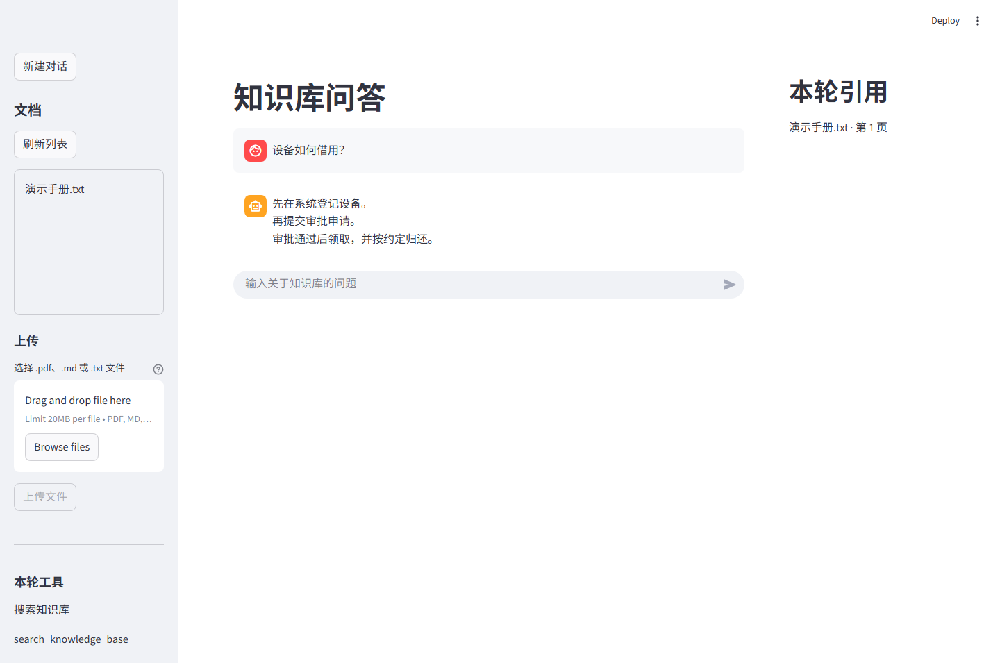
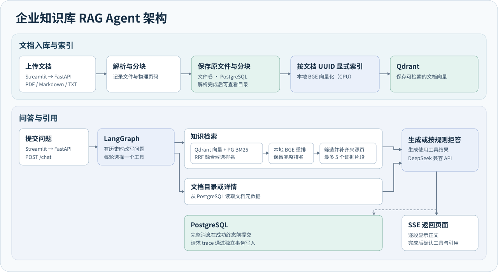
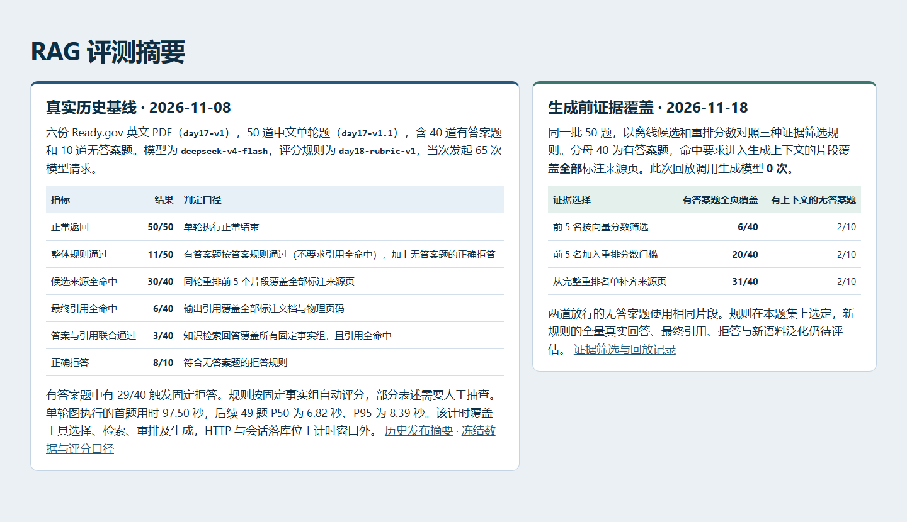

# 企业知识库 RAG Agent

把企业手册、制度和操作指引做成可检索的知识库。员工可以用自然语言提问，并通过回答旁的文件名和页码回查原文。项目用 Streamlit 提供交互界面，用 FastAPI 和 LangGraph 编排检索与问答。

[快速启动](#快速启动) · [架构](#架构) · [效果评测](#效果评测) · [界面截图](#界面截图)

## 核心功能

- **文档入库与索引**。上传 PDF、Markdown 或 TXT，解析后可在目录查看。按文档 UUID 构建向量索引。
- **带来源的流式问答**。页面逐段显示正文，正常完成后确认本轮调用的工具与引用。同一文件的同一物理页只显示一次，页码从 1 开始。
- **短期多轮与执行记录**。后续提问可使用同一会话中最近的历史，最多五个完整轮次。PostgreSQL 保存会话、消息和请求 trace，供回查本轮检索与模型用量。

## 快速启动

需要支持 BuildKit 的 Docker 和 Compose 2.17+。如果仓库根目录还没有 `.env`，将 [`.env.example`](.env.example) 复制为 `.env`，填写 `POSTGRES_PASSWORD`。真实问答需要有效的 `LLM_API_KEY` 和供应商当前支持的 `LLM_MODEL`。只检查服务启动时可以将 `LLM_API_KEY` 留空。

按部署情形选择启动方式：

- **全新部署：** 直接运行下方命令，Compose 会创建所需的命名卷。
- **复用旧数据和索引：** 沿用原数据库的库名、用户和密码，以及原 Qdrant 集合名。**运行下方命令前先停止旧的独立 Qdrant 容器**（例如 `docker stop rag-agent-qdrant`），保留 `rag-agent-qdrant-data` 和 PostgreSQL 数据卷。不要让两个 Qdrant 实例同时使用同一个卷，也不要用 `docker compose down -v`。用默认项目名 `rag-agent` 启动后，已索引的文档可直接查询，无需重新上传或索引。
- **与旧栈并行：** 不要使用默认项目名。在每条 Compose 命令的子命令前加上同一个 `-p rag-agent-demo`，并让 `APP_PORT`、`STREAMLIT_PORT` 和 `POSTGRES_PORT` 使用空闲端口。独立栈使用新卷，演示文档需要在新栈中上传并索引。

~~~powershell
docker compose up --build --wait
~~~

1. 打开 [Streamlit](http://127.0.0.1:8501)。可用 `docker compose ps` 查看服务健康情况，或打开 [FastAPI 接口文档](http://127.0.0.1:8000/docs)。

2. 如需添加新文档，在侧栏上传仓库中的 [earthquake.pdf](eval/corpus/earthquake.pdf)，复制上传提示中的文档 ID。`ready` 表示解析入库。复用已索引的文档时跳到第 4 步。
3. 将命令中的 `<UUID>` 替换为新文档的 ID，执行索引。索引命令负责创建或校验 Qdrant 目标集合并写入向量。

   ~~~powershell
   docker compose exec backend python -m backend.app.commands.index_document --document-id <UUID>
   ~~~

4. 针对已索引的文档在页面提问。如果索引了 `earthquake.pdf`，可以问「地震摇晃时，如果已经躺在床上，该怎么保护头和颈部？」。回答完成后，在右侧查看引用，在左侧查看本轮工具。
5. 用 `docker compose down` 停止并移除这组容器。命名卷中的数据库、索引、上传与缓存会保留。

首次构建需要拉取镜像和依赖，冷缓存下上传或检索可能还要下载分词文件和 BGE 模型。Compose 会初始化 PostgreSQL 项目表。无模型密钥时，也可按 [无付费页面演示](docs/day20-streamlit.md#无付费录屏) 体验交互。

宿主机端口冲突时，在 `.env` 设置空闲的端口，并相应调整访问地址。 [Compose 配置](docker-compose.yml)

## 架构

*入库和问答共用文档元数据与分块。检索模型在本地 CPU 运行，DeepSeek 兼容 API 提供问答流程中的模型调用。* [详细架构](docs/architecture.md)

## 技术亮点

- **Hybrid Search**。BGE 向量与 BM25 各取最多 20 个候选，RRF 按两路名次融合。历史受控实验在同一份手册的 12 道正样本上测得纯向量、BM25、Hybrid 的 Hit@1 分别为 **75.0%、83.3%、91.7%**，MRR@5 为 **0.812、0.882、0.944**。另 3 道库外题也均返回候选，证据筛选和拒答由后续流程负责。 [Hybrid 对照](docs/day11-hybrid-comparison.md)
- **Rerank**。BGE 重排逐对打分，重排接口返回前 5 项，问答保留完整排名用于证据筛选和补齐来源页。同组历史问题的 MRR@5 由 **0.944 升至 0.958**，其中一道题的首个相关片段由第 3 升至第 2，Hit@1 与 Hit@5 均持平。 [Rerank 对照](docs/day12-rerank-comparison.md) · [证据筛选](docs/day19-evidence-gate.md)
- **LangGraph**。首轮用原问题，有历史时先改写为独立问题，再选择并执行一个工具。只有知识检索工具走向量、BM25 和重排链路。证据筛选后进入生成或按规则拒答。SSE 传送正文，前端收到合法引用事件和完成标记后确认本轮工具与来源。 [图编排](backend/app/agent/graph.py) · [流式客户端](frontend/api_client.py)

## 效果评测

真实历史基线与生成前离线回放使用同一批 **50 道中文单轮题**和 **6 份英文 PDF**，两次测量分别取自不同阶段。

| 记录 | 测量阶段 | 结果 |
| --- | --- | --- |
| 2026-11-08 真实基线 | 单轮执行和生成后评分 | 正常返回 **50/50**，整体规则通过 **11/50**，最终引用全命中 **6/40**，正确拒答 **8/10** |
| 2026-11-18 离线回放 | 生成前，入选上下文包含全部标注来源页 | **6/40 → 20/40 → 31/40**，无答案题进入上下文维持 **2/10** |

整体规则通过统计符合答案规则的有答案题与正确拒答的无答案题，不要求有答案题的引用全命中。最终引用按标注文件名和物理页码另算。离线回放测量的是模型可用的证据，新规则下的全量答案、最终引用和拒答表现仍待评估。 [公开评测摘要](docs/evaluation-summary.md) · [评测输入与复现](eval/README.md)

*评测截图来自本仓库的公开摘要，数据为上述历史运行。*

## 界面截图

*无付费替身演示。问题、回答和文档均为合成内容。* [复现步骤与真实 SSE 验收记录](docs/day20-streamlit.md)

## 开发和参考

- 本机开发使用 Python 3.11。后端启动与回归命令见 [AGENTS.md](AGENTS.md)，前端本机启动见 [Streamlit 指南](docs/day20-streamlit.md#环境与启动)。
- 接口契约可在本机 [FastAPI 文档](http://127.0.0.1:8000/docs) 查看。请求 trace 和管理员查询见 [可观测性记录](docs/day19-observability.md)。
- 环境与历史实验记录见 [Docker Desktop 恢复记录](docs/docker-desktop-recovery.md)、[多轮记忆设计](docs/day16-conversation-memory.md) 和 [离线分块对照](docs/day19-chunk-comparison.md)。
- 历史验收、技术决策与恢复检查点见 [STATUS.md](STATUS.md)、[DECISIONS.md](DECISIONS.md) 和 [HANDOFF.md](HANDOFF.md)。
