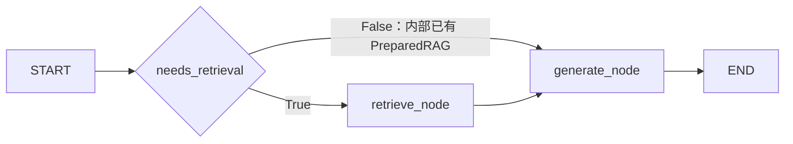

# Day14：RAG 迁移到 LangGraph

迁移验收日期：2026-10-29（Asia/Shanghai）；用户完成确认与本地提交日期：2026-10-30。
当前分支 `codex/day14-langgraph`，本提交收录完整 Day14；
精确 HEAD 提交后由 git log -1 核验，父提交为
`34712772b3682d174f459da91100b09f8a2493cc`。未推送或合并，Day15 未开始。
用户已确认审查、测试与修复通过，并授权同步完成状态：
PLAN Day14 五项与开发日志已勾选，Day13 标记保留原样。

## 前置验收与范围

开始实现前，已核验既有 Day13 学习包中的笔记、可编辑图、PNG、官方无 Key 示例和运行记录。
学习包位于仓库外临时目录
`C:\Users\袁伟鑫\AppData\Local\Temp\rag-agent-day13-71af7f75cf91462a8d38247a5b2fa22a`；
没有在本轮重做 Day13，也没有把学习产物混入 Day14 代码。
官方示例与官方原文逐字一致，Python 3.11.15 / LangGraph 1.2.16，
一次 invoke 得到 human `hi!`、AI `hello world`，网络和 dotenv 访问均为 0；
笔记包含 State/Node/Edge/Compile、条件边、Context 与 14 项自测。
这些是文件和运行证据，不代表代替用户完成理解自检。临时目录并非永久归档。

| Day13 产物 | 已核验 SHA256 |
|---|---|
| day13-langgraph-notes.md | e20e0380d83fa7bd80d7b19979bd6fcd82ac12ebce5f2de71e6bbe655e7261a2 |
| day13-agent-graph.drawio | 829cc53016d41471afb6e74a0936255e452d2105f9cce59966aa9edd6b6f4a9d |
| day13-agent-graph.png | aeab32842db94515f181523c4af7d0516d109388e0af938d15232be4b8e5fde4 |
| official-hello-world.py | 6a6b00d5709cb40e8e644adc111dd3afa21b26ee202df0197966dde3b9285268 |

本轮只迁移编排层：沿用现有检索、Prompt、来源和 LLM 客户端。
没有 ToolNode、工具选择、会话、checkpointer、记忆、LangSmith 导出或新管理接口；
未修改检索参数、模型、阈值、上传和索引流程。

## 图、State 与模块职责



[实际编译图导出的 Mermaid](day14-agent-graph.mmd) 来自
`build_rag_graph(...).get_graph().draw_mermaid()`，未使用在线渲染服务。

| State 字段 | 初始值及用途 |
|---|---|
| query | 规范化问题，长度 1..4096 |
| retrieved_docs | `()`；检索后保留完整 Rerank Top5，不先丢弃门控未通过项 |
| prepared | `None`；检索后为现有 PreparedRAG，承载 messages/sources/has_relevant_context |
| answer | 空字符串；由 generate_node 写入 |
| tool_calls | `()`；始终为空，不执行工具 |
| needs_retrieval | 公共请求固定 True；retrieve_node 完成后改为 False |

`AgentContext` 只有 `response_mode: Literal["complete", "stream"]`。
服务依赖由节点工厂闭包注入；没有放入 State，没有 reducer，没有持久化。

| 文件 | 职责 |
|---|---|
| [state.py](../backend/app/agent/state.py) | State、局部更新、Context、公共初始状态 |
| [nodes.py](../backend/app/agent/nodes.py) | retrieve/generate 节点及单次流的取消与背压控制 |
| [graph.py](../backend/app/agent/graph.py) | 严格布尔条件路由、两个节点及 compile |
| [service.py](../backend/app/agent/service.py) | invoke、流式预取、事件校验、迭代器与资源生命周期 |
| [rag.py](../backend/app/services/rag.py) | 保留 RAGService 名称，懒加载并缓存图，复用全部既有业务辅助函数 |
| [chat.py](../backend/app/api/chat.py) | 保持 HTTP/JSON/SSE 契约和错误映射，处理 ASGI 中断清理 |

`get_rag_service()` 仍缓存服务；每个服务的 `cached_property _runner` 首次执行时才编译图。
启动及 `/health` 不构图、不连接 PostgreSQL/Qdrant、不加载模型、不调用 LLM。

## 两种执行模式

非流式：`RAGService.complete(question) → graph.invoke(..., context=complete)`。
retrieve_node 只调用一次 RerankedRetrievalService，再依次使用原有
`select_relevant_chunks()`、`build_rag_messages()` 和 `build_sources()`；
generate_node 复用 complete_messages 和来源清理，最终映射为原 RAGAnswer。

流式：`start_stream(question)` 创建
`graph.stream(..., stream_mode=["updates", "custom"], version="v2")`，
先消费到 retrieve_node 的 update，取得 PreparedRAG，才返回 HTTP 流。
响应建立后继续消费同一迭代器；没有第二次检索或第二次图运行。
只有 `{"type":"delta","delta":str}` custom 数据可转为正文，State update 不进入 SSE。

自有 LLMClient 不是 LangChain ChatModel，因此使用
[官方 custom streaming 方案](https://docs.langchain.com/oss/python/langgraph/streaming)。
节点返回局部更新，遵循 [Graph API](https://docs.langchain.com/oss/python/langgraph/use-graph-api)。

为避免同步图的工作线程提前读完答案，单次运行的 StreamControl 在发出每个 delta 后等待消费者确认。
消费者读取下一条时才继续拉取上游；没有缓冲完整答案后再伪装流式输出。
控制对象通过 Runtime RunControl 传递，不属于 State 或 AgentContext。

PreparedRAGStream 使用独立 Context 和锁串行推进同一生成器，兼容 FastAPI 预取与响应消费
发生在不同工作线程的情况。结束、异常、关闭以及 ASGI 断连均发出取消信号，
关闭 graph iterator、sanitizer 和上游 LLM iterator；close 幂等。
ASGI 清理使用取消保护，避免中断跳过清理。已有上游同步读取若正在阻塞，
退出仍受现有 LLM timeout（默认 60 秒）约束；没有声称能强行打断任意阻塞 I/O。

兼容旧内部实验调用的 `prepare() → complete(PreparedRAG)/stream(PreparedRAG)`：
prepare 复用同一个 retrieve_node，生成进入 False 分支，避免重复检索。
公共 /chat 始终传入问题字符串并从 True 开始；HTTP 没有新增跳过检索参数。
False 分支若缺少合法 PreparedRAG 会安全失败。

## 保持的行为与错误分层

- 向量/BM25 各 20 → 等权 RRF k=60 取 20 → 固定 CPU BGE Rerank5 →
  原始 `vector_score >= 0.46`；RRF/logit 不用于证据门，BM25-only 仍不作为生成依据。
- 无相关知识精确返回“知识库中没有相关信息”；LLM 调用 0。
  正常相关请求检索、Reranker 和 LLM 各执行一次。
- Prompt、来源去重、跨 delta 伪造引用清理保持原实现；sources 只来自后端 Chunk metadata。
- JSON 字段仍为 answer/model/sources；成功 SSE 仍为 delta → sources → [DONE]。
  LLM 流失败仍发送 error 后停止，不发送 sources/DONE。
- 请求/Embedding/Reranker 超限 422，内部检索计算失败 500，非法结果 502，服务不可用 503；
  检索异常在 SSE 建立前按原映射返回。非流式 LLM 失败保持 502。
  新的内部图协议错误使用安全 500 或流内 error，不公开 State/异常原文。
- 每次图运行显式关闭 tracing、清空 callbacks；即便环境开启 LangSmith，也不导出 State。
  API 错误日志只记录固定文本或异常类型，不打印 query、Prompt、Chunk 或上游异常正文。

迁移前后完整 OpenAPI JSON 精确相等；15 个原有模块级 RAG 辅助函数的 AST 精确一致。
2026-10-29 迁移验收时 18 个保护文件 SHA256 均未变化，历史清单见 [机器记录](day14-langgraph-results.json)。
2026-10-30 本地提交阶段，PLAN 按用户授权更新 Day14 标记，其余 17 项保护文件保持原样。
包括 PLAN、配置/启动、LLM、全部既有检索服务、独立 rerank API、Day12 实验 MD/JSON
和严格质量回归；没有删除、放宽既有验收断言或更改质量常量。

## 实际测试与结果

| 日期/阶段 | 实际结果 | 范围 |
|---|---|---|
| 2026-10-30 本地提交前完整标准 | **453 passed / 12 skipped，23.34s** | 完整 backend/tests；用户确认审查修复通过后重跑，dotenv/外部服务连接均 0 |
| 2026-10-29 迁移前完整标准 | 403 passed / 12 skipped，4.11s | 真实集成关闭，模型离线，dotenv/外部连接均 0 |
| 2026-10-29 迁移后完整标准 | **453 passed / 12 skipped，31.10s** | 465 项；新增 50 项；dotenv/外部连接均 0 |
| 2026-10-29 真实局部验收 | **3 passed，160.84s** | 两个模块的 2 项真实测试和 1 项普通质量退化回归；本地 PG/Qdrant/BGE/Reranker，LLM 替身 |
| 2026-10-28 历史全部真实 | 413 passed，158.94s | Day12 历史证据，本轮没有重跑全部真实集成 |

新增测试覆盖 State、节点、实际图两条条件边、无 checkpointer、懒加载/单次 compile、
拒答零 LLM、预取后尚未调用 LLM、首 delta 到达时尚未读取下一段、单次检索、
跨线程消费与 close、ASGI 断连关闭上游、异常/空输出/伪造引用、严格 custom 事件、
HTTP/SSE 错误、日志和 tracing 不泄露 State、健康检查零依赖。

标准运行使用仓库外检查器调用 pytest，并禁止 dotenv/服务连接；真实局部运行只允许本地端口，
将真实 LLMClient 调用替换为立即失败的守卫。真实局部共 2 次配置文件只读打开，
写入尝试/外部连接/付费 LLM 尝试均 0；已有本地服务和模型可用，未启动/重启服务或下载模型。
两类运行均禁用 pytest 缓存插件，使用新的独占临时目录。

核心测试入口如下；具体隔离参数和原始日志保存在本轮临时证据目录，命令样例并非后续执行授权：

```powershell
.\.venv\Scripts\python.exe -m pip check
.\.venv\Scripts\python.exe -m pytest backend/tests -v
.\.venv\Scripts\python.exe -m pytest backend/tests/test_rag_integration.py backend/tests/test_rerank_comparison_integration.py -v
```

真实局部须显式开启 RUN_POSTGRES_INTEGRATION、RUN_QDRANT_INTEGRATION、
RUN_LOCAL_EMBEDDING_INTEGRATION、RUN_RAG_INTEGRATION、RUN_RERANKER_INTEGRATION，
并使用离线模型与 LLM 替身。DAY12_RERANK_REPORT_JSON 只能指向不存在的新路径；
本轮指向临时目录的 day14-real-quality.json，未覆盖 Day12 历史报告。

同一 24 Chunk / 12 正样本 / 3 负样本重新测得：

| 方法 | Hit@1 | Hit@5 | MRR@5 |
|---|---:|---:|---:|
| Hybrid | 0.917 | 1.000 | 0.944 |
| Rerank | 0.917 | 1.000 | 0.958 |

严格逐题首次命中、20 候选/0 截断和聚合常量均通过；3 负样本拒答，LLM 调用 0。
真实 RAG 的 JSON 和 SSE 路径均通过。该受控语料结论不能外推到自然长文、表格或多跳问答。
测试 finally 清理后，独立只读核验 Document、Chunk、临时 Qdrant collection 均为 0。

原始日志、OpenAPI 快照、检查器和新实验输出位于
`C:\Users\袁伟鑫\AppData\Local\Temp\rag-agent-day14-feb71aa9c2e74566b33c1213b211cc47`。
摘要与保护文件哈希已归档到 [results.json](day14-langgraph-results.json)；
临时日志不含凭据，临时目录可能被系统清理。

## 依赖、失败记录与交付边界

只增加直接依赖 `langgraph==1.2.16`；安装新增 langgraph、
langgraph-checkpoint 4.3.1、langgraph-prebuilt 1.1.1、langgraph-sdk 0.4.10、
ormsgpack 1.13.0，既有依赖版本未调整。未安装完整 langchain。
`pip check` 返回 `No broken requirements found.`。包名包含 checkpoint/prebuilt
不表示项目启用了 checkpointer 或工具。

本轮没有功能测试失败。检查器的修正独立于业务代码：迁移前 runner 的提前 import
产生 1 条 anyio 重写警告，调整 pytest/import 顺序后最终无警告；
本机临时目录写入权限问题用获准的新独占目录处理；
离线模型探针曾错误要求 Embedding 使用 safetensors/完整 Rerank snapshot，
随后按生产文件白名单核验成功；清理核验改为显式关闭 QdrantClient。
没有为这些检查器问题修改受保护业务文件或降低测试要求。

2026-10-29 通过 GitHub 实时接口确认 Day12 分支已经发布为
[3471277](https://github.com/itysrw/rag-agent/commit/34712772b3682d174f459da91100b09f8a2493cc)，
master 仍为 [b68b590](https://github.com/itysrw/rag-agent/commit/b68b590c8262eb568a371c895e4f7033456d045c)；
先前文档的“Day12 未推送”属于历史状态，不能继续当作现状。
2026-10-30 用户确认审查、测试与修复通过并要求提交 Day14 代码、更新相关状态。
本次仅更新完成/提交状态与测试记录，未改已审查源码、测试或依赖；
16 个实现/测试/依赖文件起止哈希一致。提交前标准重新通过 453/12（23.34s），
没有重跑真实集成、操作服务、下载模型或付费调用，也未复查远端。

PLAN 只更新 Day14 五项、完成确认和开发日志；Day13 与 Day15 以后保持原样。
当前 PLAN SHA256：
`C1A6DBB5C081C15EA285A2826548D13806B147F2541569EB81017D188FB31099`。
原 10月29迁移阶段 PLAN SHA256 `FDA329ABC06FBDA6B05642832A0386372D06592598106F61270845B0577E9FA1`
保留为历史证据，不作为当前哈希。

本提交收录 27 个相关路径：提交前 15 个 tracked 变更（含删除 .gitkeep）、12 个新增，
提交后相关改动应为 0、暂存区应为空。精确提交哈希以 git log -1 核验；
没有在提交内容中伪造自身哈希。无关 .agents/ 和 PDF 保留且不进入提交。
未推送、未合并，Day15 未开始。D-001 至 D-058 技术决策正文保留原样。

本次提交整理静态核验：71 个本地链接有效，OpenAPI 与迁移前快照精确一致，
PLAN 差异限定为 Day14，17 项其余保护文件与 16 个已审查实现/测试/依赖文件未变；
pip check 和 git diff --check 均通过。
